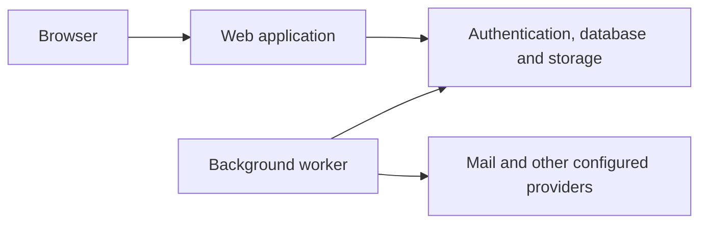

# 🧩 Architecture / Architectuur

## Components

The web application uses React and TanStack Start/Router/Query. Routes and UI live
under `src/routes` and `src/components`; shared and server-side modules live under
`src/lib`. Supabase supplies authentication, PostgreSQL access and storage.
Background processes under `worker` handle asynchronous work and integrations.

## Trust boundaries

Browser configuration contains only values intended for clients. Privileged keys
remain server-side. Server handlers validate the caller and resource access;
database policies and grants enforce additional boundaries. Trip membership and
agency workspace roles determine access to their respective resources.

Provider responses, imported mail, uploads and external URLs are untrusted input.
The source includes validation, scoped access helpers and controlled processing
for these inputs. A control's presence is not proof of the configuration of a
particular hosted environment.

This viewing edition does not include database deployment, server configuration
or production administration tools. Documentation-only addresses in source are
examples and must not be interpreted as operational endpoints.

## Nederlands

De webapp, gegevensopslag en achtergrondprocessen hebben afzonderlijke taken en
vertrouwensgrenzen. Toegang wordt gecontroleerd in serverfuncties en via
databaserechten en beleid. Externe inhoud blijft onbetrouwbare invoer.
Deze uitleg bevat geen productie-inventaris of beheerroute.
